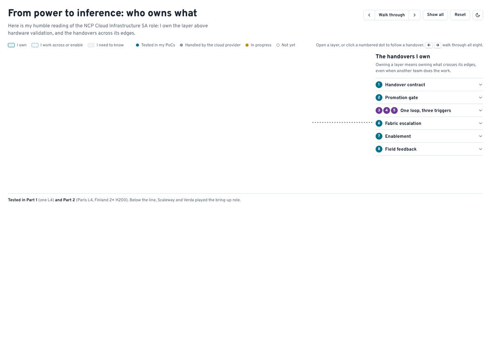
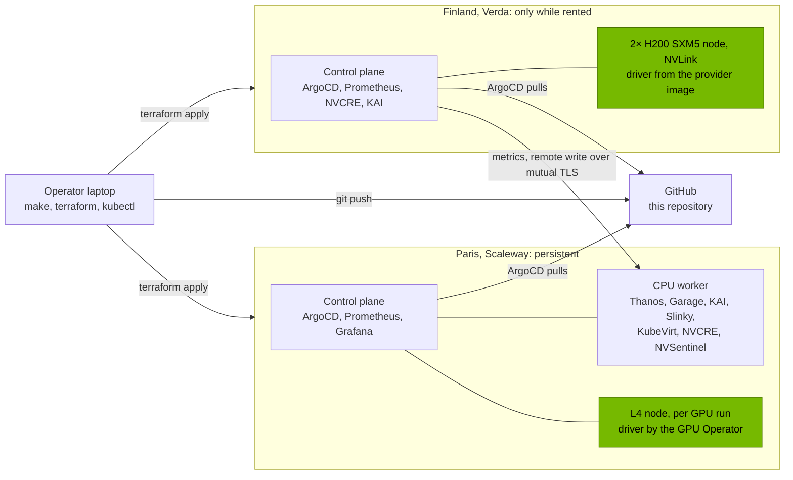

<h1 align="center">Nordhaven: a GPU cloud partner from hardware handover to first workloads</h1>

<p align="center">
  <b>Pin a known-good stack · prove a node ready · survive a failing GPU · share GPUs fairly · one view of two sites</b><br/>
  on an L4 in Paris and 2× H200 in Finland, two providers, one Git repository<br/>
  AICR · NVCRE · NVSentinel · KAI Scheduler · MIG · Slinky · Thanos · KubeVirt
</p>

<p align="center">
  <a href="https://yassineteimi.github.io/ncp-partner-onboarding/"><b>Read the documentation</b></a>
</p>

---

A new NVIDIA Cloud Partner gets its hardware long before it gets its first tenant, and
the months in between go into the same questions every time: which versions go
together, how to prove a node is ready, what happens when a GPU fails, how teams share
GPUs that never cover demand. Nordhaven is a fictional European partner going through
exactly that, with an inference pool in Paris and a training pool in Finland from two
different providers.

[](https://yassineteimi.github.io/ncp-partner-onboarding/ownership-map/)

This is Part 2 of my GPU fleet work. [Part 1](https://github.com/yassineteimi/nvidia-gpu-fleet-poc)
built Day 2 operations by hand on one NVIDIA L4. Here NVIDIA's open tools take over
those jobs on two sites, upstream Kubernetes 1.36 through kubeadm on both, synced by
ArgoCD from this repository. Where Part 1 did the same job, I compare the two on the
same GPU model.

## Seven use cases, two sites

| Use case | What happened | NVIDIA piece |
| --- | --- | --- |
| [Pin a known-good stack per hardware class](https://yassineteimi.github.io/ncp-partner-onboarding/10-day0-aicr/) | Part 1's hand-pinned versions compared with AICR's locked H200 recipe; AICR refuses the provider's Ubuntu 26.04 | AICR |
| [Prove a node ready before it takes work](https://yassineteimi.github.io/ncp-partner-onboarding/10-day1-nvcre/) | The H200 node certified at 351 GB/s all-reduce over NVLink, then promoted out of its staging taint | NVCRE |
| [From GPU fault to return to service](https://yassineteimi.github.io/ncp-partner-onboarding/10-day2-nvsentinel/) | XID 79 to training resumed in 288.8 s with no human action, against 360.9 s with Part 1's controller; goodput 73.0% against 66.4% | NVSentinel |
| [Share scarce GPUs between tenants](https://yassineteimi.github.io/ncp-partner-onboarding/20-tenancy/) | A 2-pod gang bound in 1 s, a 3-pod gang on 2 GPUs never partly bound, two tenants on separate MIG slices of one H200 | KAI Scheduler, MIG |
| [Run a Slurm group on the same cluster](https://yassineteimi.github.io/ncp-partner-onboarding/21-hpc-slinky/) | `sbatch` jobs, a prolog that drains a sick node, a Kubernetes cordon that drains Slurm | Slinky |
| [One metrics view across sites](https://yassineteimi.github.io/ncp-partner-onboarding/30-metrics-across-sites/) | H200 series in Paris about 4 s after Finland's Prometheus started, still queryable after the site was deleted | Thanos |
| [VM tenants next to containers](https://yassineteimi.github.io/ncp-partner-onboarding/30-vm-tenants/) | A VM booted on KVM in 20.2 s under a tenant quota while a training job used the L4 | KubeVirt |

The GPU work ran on real hardware: one L4 on 21 October and a 2× H200 SXM5 node on
22 October. Faults were injected, because a rented GPU doesn't fail on request, and
[this page](https://yassineteimi.github.io/ncp-partner-onboarding/simulated/) lists
everything that was simulated. Every result links to output committed during its run.
Each technology choice has a [decision record](https://yassineteimi.github.io/ncp-partner-onboarding/adr/)
with the alternatives I considered.

## Architecture



Every component, the network and the sync order are on the
[architecture page](https://yassineteimi.github.io/ncp-partner-onboarding/architecture/).

## Repository layout

```text
ncp-partner-onboarding/
├── docs/          # the published site (MkDocs Material) and every run's evidence in docs/artifacts/
├── terraform/     # par (Scaleway) and fin (Verda): nodes, firewalls, startup scripts
├── gitops/        # one ArgoCD app-of-apps per site: Applications, Helm values, manifests
├── workloads/     # acceptance pods, the goodput trainer, readiness and scheduling jobs
├── scripts/       # bring-up and teardown per site, and each use case's drivers and captures
└── mk/            # make targets per area, included by the top-level Makefile
```

## Quick start

```bash
cp .env.example .env    # Scaleway and Verda API keys (gitignored)
make par-cluster        # Paris: private network and the persistent control plane, once
make par-argocd         # install ArgoCD and hand it this repository, once
make par-cpu-up         # power on the CPU worker
make par-gpu-up         # add the L4 node; make par-acceptance tests it
make fin-preflight      # Finland: is a 2x H200 orderable, does the balance cover the run
make fin-up             # Finland: control plane, ArgoCD, then the H200 node
make fin-acceptance     # Part 1's acceptance test on the H200
make fin-down           # delete the whole Finland site with its volumes, then sweep
make par-gpu-down       # remove and destroy the L4 node
make par-cpu-down       # power the CPU worker off; its disk stays
make cost               # what each node has run and cost
```

## Cost

The L4 run cost about €0.63 and the H200 run about $7, because Verda bills in
10-minute blocks and the Finland site existed for 41 minutes. Everything else is the
Paris control plane at €0.055 an hour and the CPU worker at €0.29 an hour when it's on.
In total: about €11 on Scaleway and $8 on Verda, before VAT.

## Secrets

API keys live in a gitignored `.env`. Kubeconfigs, Terraform state and join tokens stay
on the laptop or on the nodes and never reach Git or the published site. Join tokens
are created on demand with a 30-minute lifetime.

## Stack


## Contact

[](https://linkedin.com/in/yassine-teimi)
[](mailto:yteimi@gmail.com)

---
<p align="center"><sub>Independent work, not affiliated with or endorsed by any vendor named here. Nordhaven is fictional.</sub></p>
