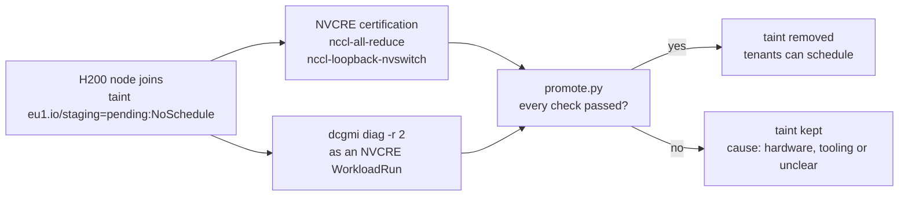

# Day 1: no workloads until the node is certified

!!! abstract "The use case"
    A new GPU node joins EU1's training pool with a staging taint, so nothing but its own
    tests can run on it. NVIDIA's Cluster Readiness Engine (NVCRE) certifies it, a DCGM
    diagnostic checks the hardware, and a small gate removes the taint only if both
    passed. Part 1 had burn-in scripts and a runbook; this makes the check a gate in front
    of tenants.

!!! success "Ran on par's L4 (W1, 21 October) and fin's 2× H200 (W2, 22 October)"
    The H200 node was certified at 351 GB/s all-reduce bus bandwidth over NVLink and
    opened to tenants 19 min 39 s after it was Ready, image pull included. One gap
    showed up that the gate didn't catch: ECC is off on Verda's H200s, so the DCGM
    diagnostic skipped its memory test and still passed. [Results](#results).

## The gate

The taint goes on at join, through the node's kubeadm `JoinConfiguration`, so there's no
moment when the node is schedulable before it's checked. The GPU Operator's operands and
NFD tolerate it, since the node is useless until they run. NVCRE injects the same
toleration into its own workload pods through `taintSelectors`, and its run only targets
nodes that still carry the taint. NVCRE itself never taints, cordons or labels a node
(its README says so), so promotion is mine: `promote.py` reads NVCRE's results file and
the diagnostic log and says yes only when everything passed.

When it says no, it also says why, because the next step depends on it. A hardware
failure stops the work planned on that node. A tooling failure (the run didn't finish,
an image couldn't start) allows an override that's recorded and labelled. Anything in
between, for example NCCL leaving NVLink inside one node while the diagnostic is clean,
goes to me to decide.

## What NVCRE needed on this hardware

Read in the source and docs at v0.8.0, and checked by rendering the runs offline with
`nvcrectl`:

| NVCRE default | On EU1's nodes | Set to |
|---|---|---|
| An H200 node has 8 GPUs | Verda's `2H200.141S.88V` is a two-GPU slice of an HGX board; the run finds no node able to supply 8 and fails | `gpusPerNode: 2` |
| The L4 isn't in the catalog | It falls back to 4 GPUs per node, with a warning | `gpusPerNode: 1` |
| No thresholds | PASSED only means the test ran | A bus bandwidth floor on fin (below) |
| Only DCGM category: level 4 | Hardcoded `--run 4`, about 90 minutes on healthy hardware | `dcgmi diag -r 2` beside the certification, level 3 in a later window |
| Controller "needs a node without GPUs" | The docs say so, the chart doesn't enforce it | A required node affinity on `nvidia.com/gpu.present DoesNotExist` |
| `nccl-loopback` | Disables P2P and shared memory, so it tests the network path, not NVLink | `nccl-loopback-nvswitch`, the variant that keeps P2P on |

## The threshold, and where it comes from

No published figure gives the all-reduce bus bandwidth of two H200s in one node, and I
won't invent one. What I can say from NVIDIA's H200 page is that PCIe Gen5 carries 128
GB/s in total, 64 GB/s each way, and NVLink 900 GB/s, about 450 each way. So the floor
is 64 GB/s: above it, the traffic can only have crossed NVLink. It proves the path, not
the performance, and I report the measured figure against 450.

The NCCL log is kept raw, with `NCCL_DEBUG=INFO`, so the transport each channel used is
on record too.

## The image and the driver

NVCRE runs its NCCL tests in `nvcr.io/nvidia/pytorch:26.01-py3`, built for driver
590.48.01 (CUDA 13.1.1). fin's provider image ships driver 580.178.04, so on the H200
the test only runs through CUDA forward compatibility. The fallback is
`pytorch:25.11-py3`, built for 580, and I checked its layers for the two binaries the
test calls: `/usr/local/bin/all_reduce_perf_mpi`, and `mpirun` through `/usr/local/mpi`,
a link to HPC-X. Read, not run. Both images are pinned by digest.

## The L4 rehearsal

On one GPU an all-reduce has one rank, and its bus bandwidth is 0 by definition. So W1's
run on the L4 tests only the plumbing: the taint, the injected toleration, the results
file, the NCCL log capture, the diagnostic as a `WorkloadRun`, and the gate. It says
nothing about the L4, and nothing on this page will read it as if it did.

## Results

### The H200 node, from Ready to open

On 22 October fin's GPU node joined already carrying `eu1.io/staging=pending:NoSchedule`.
Times are UTC.

| Time | Step |
|---|---|
| 09:54:10 | Node Ready, tainted; the GPU Operator and NFD start on it |
| 09:55:44 | 2 GPUs allocatable |
| 09:56:33 to 10:02:07 | NVCRE's image (9.1 GB) pulled ahead of the run, 3 min 7 s once its turn came |
| 10:02:42 | cos's acceptance test passed (cuda-vectoradd, `nvidia-smi`), on the same taint toleration |
| 10:03:07 to 10:12:08 | NVCRE certification, both categories, one after the other |
| 10:12:41 to 10:12:54 | `dcgmi diag -r 2` on both GPUs, as an NVCRE `WorkloadRun` |
| 10:13:49 | The gate passed all 7 checks and removed the taint |

19 minutes 39 seconds from Ready to open, more than a quarter of it pulling images. Part 1's
burn-in took three hours on one L4 and ended with a person running a checklist.

### What the certification measured

| Category | Runtime | Bus bandwidth (16 GB messages) | Against the 64 GB/s floor | Against NVLink's ~450 GB/s each way |
|---|---|---|---|---|
| `communication/nccl-all-reduce` | 4 min 31 s | 351.45 GB/s | 5.5× | 78% |
| `communication/nccl-loopback-nvswitch` | 4 min 27 s | 351.87 GB/s | 5.5× | 78% |

The raw NCCL log says how the bytes travelled: NCCL 2.29.2 built a graph of type
`NVL/PIX` and connected all 24 channels in each direction `via P2P/direct pointer`;
across the two runs the gate counted 104 NVLink channel lines and none over the network
([NCCL log](https://github.com/yassineteimi/ncp-partner-onboarding/blob/main/docs/artifacts/readiness/nvcre-fin-20261022T100307Z-nccl.log),
[report](https://github.com/yassineteimi/ncp-partner-onboarding/blob/main/docs/artifacts/readiness/nvcre-fin-20261022T100307Z-report.txt)).
The diagnostic's own PCIe test, on the same GPUs, measured 53 to 57 GB/s each way, so
the floor sat where it should: just above what PCIe delivers, far below what NVLink did.

NVCRE's summary prints `Transport: Socket` next to those numbers. That's the name of
NCCL's network plugin for traffic between nodes, which a run inside one node never uses;
the gate reads the channel lines instead, and wasn't fooled
([finding](findings.md#nvsentinel-nvcre-and-aicr)).

The image question resolved itself: `pytorch:26.01-py3`, built for driver 590, ran on
fin's 580.178.04, which it can only do through CUDA forward compatibility (the log
reports `cudaDriverVersion` 13000 and 13010), so the 25.11 fallback stayed unused.

### The diagnostic, and the gap in it

`dcgmi diag -r 2` passed overall in 13 seconds: the software and PCIe tests passed on
both GPUs, and the memory test was **skipped** on both, with "Skipping test Memory
because ECC is not enabled". Verda's 2× H200 instance runs with ECC off, and turning it
on takes `nvidia-smi -e 1` and a GPU reset, which I don't do inside a shared window
([diag log](https://github.com/yassineteimi/ncp-partner-onboarding/blob/main/docs/artifacts/readiness/diag-fin-20261022T101241Z.log),
[finding](findings.md#verda)).

DCGM counts a skip as a pass, so did my gate, and the node opened with no memory check.
That's the rule as I wrote it, and it's wrong for a partner: a gate in front of tenants
should require ECC on, or treat a skipped memory test as "unclear" and ask a person. ADR
0004 records it as the next change to the gate.

### The L4 rehearsal

On 21 October in W1 the same gate ran on par's L4 with `gpusPerNode: 1`: staged at
17:23:23 UTC, certified in 1 min 57 s, diagnostic passed in 11 s (software, memory and
PCIe, ECC being on there), promoted at 17:25:54. The bus bandwidth was 0, as it has to be
with one rank, so this proved the plumbing (the taint, the injected toleration, the
results file, the log capture, the diagnostic as a `WorkloadRun`, the gate) and nothing
about the L4 ([report](https://github.com/yassineteimi/ncp-partner-onboarding/blob/main/docs/artifacts/readiness/nvcre-par-20261021T172328Z-report.txt),
[gate](https://github.com/yassineteimi/ncp-partner-onboarding/blob/main/docs/artifacts/readiness/promote-par-20261021T172554Z.txt)).

### What level 2 didn't check

Level 2 isn't NVCRE's level 4: no targeted power or targeted stress (20 minutes each),
no nvbandwidth, and here no memory test either. Level 3 on both H200s is the request for
W3, and the memory test only runs there if ECC is on.

## What one node can't show

Inter-node fabric: there's one node, so no InfiniBand, RoCE or cross-node NVLink.
NVSwitch at rack scale, which NVCRE's multi-node categories exist for. And the training
categories, which need at least 4 GPUs (`nemotron5-8b`) or 32 (`nemotron5-56b`).
