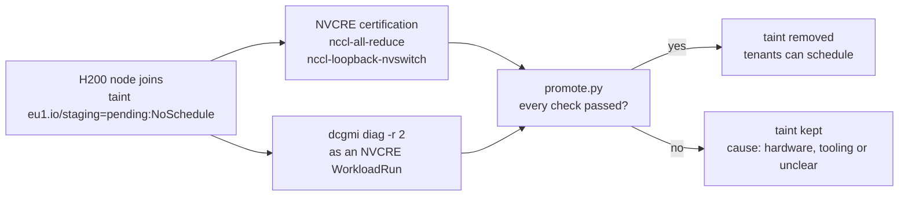

# Day 1: no workloads until the node is certified

!!! abstract "The use case"
    A new GPU node joins EU1's training pool with a staging taint, so nothing but its own
    tests can run on it. NVIDIA's Cluster Readiness Engine (NVCRE) certifies it, a DCGM
    diagnostic checks the hardware, and a small gate removes the taint only if both
    passed. Part 1 had burn-in scripts and a runbook; this makes the check a gate in front
    of tenants.

!!! warning "Planned: W2, Thursday 22 October, 19:00 Paris, on 2× H200"
    A single-GPU rehearsal of the gate runs first on par's L4 in W1. Until the windows
    have run, the results tables say "planned" and hold no numbers.

## The gate

The taint goes on at join, through the node's kubeadm `JoinConfiguration`, so there's no
moment when the node is schedulable before it's checked. The GPU Operator's operands and
NFD tolerate it, since the node is useless until they run. NVCRE injects the same
toleration into its own workload pods through `taintSelectors`, and its run only targets
nodes that still carry the taint. NVCRE itself never taints, cordons or labels a node
(its README says so), so promotion is mine: `promote.py` reads NVCRE's results file and
the diagnostic log and says yes only when everything passed.

When it says no, it also says why, because the next step depends on it. A hardware
failure stops the work planned on that node. A tooling failure (the run didn't finish,
an image couldn't start) allows an override that's recorded and labelled. Anything in
between, for example NCCL leaving NVLink inside one node while the diagnostic is clean,
goes to me to decide.

## What NVCRE needed on this hardware

Read in the source and docs at v0.8.0, and checked by rendering the runs offline with
`nvcrectl`:

| NVCRE default | On EU1's nodes | Set to |
|---|---|---|
| An H200 node has 8 GPUs | Verda's `2H200.141S.88V` is a two-GPU slice of an HGX board; the run finds no node able to supply 8 and fails | `gpusPerNode: 2` |
| The L4 isn't in the catalog | It falls back to 4 GPUs per node, with a warning | `gpusPerNode: 1` |
| No thresholds | PASSED only means the test ran | A bus bandwidth floor on fin (below) |
| Only DCGM category: level 4 | Hardcoded `--run 4`, about 90 minutes on healthy hardware | `dcgmi diag -r 2` beside the certification, level 3 in a later window |
| Controller "needs a node without GPUs" | The docs say so, the chart doesn't enforce it | A required node affinity on `nvidia.com/gpu.present DoesNotExist` |
| `nccl-loopback` | Disables P2P and shared memory, so it tests the network path, not NVLink | `nccl-loopback-nvswitch`, the variant that keeps P2P on |

## The threshold, and where it comes from

No published figure gives the all-reduce bus bandwidth of two H200s in one node, and I
won't invent one. What I can say from NVIDIA's H200 page is that PCIe Gen5 carries 128
GB/s in total, 64 GB/s each way, and NVLink 900 GB/s, about 450 each way. So the floor
is 64 GB/s: above it, the traffic can only have crossed NVLink. It proves the path, not
the performance, and I report the measured figure against 450.

The NCCL log is kept raw, with `NCCL_DEBUG=INFO`, so the transport each channel used is
on record too.

## The image and the driver

NVCRE runs its NCCL tests in `nvcr.io/nvidia/pytorch:26.01-py3`, built for driver
590.48.01 (CUDA 13.1.1). fin's provider image ships driver 580.178.04, so on the H200
the test only runs through CUDA forward compatibility. The fallback is
`pytorch:25.11-py3`, built for 580, and I checked its layers for the two binaries the
test calls: `/usr/local/bin/all_reduce_perf_mpi`, and `mpirun` through `/usr/local/mpi`,
a link to HPC-X. Read, not run. Both images are pinned by digest.

## The L4 rehearsal

On one GPU an all-reduce has one rank, and its bus bandwidth is 0 by definition. So W1's
run on the L4 tests only the plumbing: the taint, the injected toleration, the results
file, the NCCL log capture, the diagnostic as a `WorkloadRun`, and the gate. It says
nothing about the L4, and nothing on this page will read it as if it did.

## Results

!!! note "Planned"
    W1: the L4 rehearsal of the gate. W2: the H200 certification report, bus bandwidth
    against the NVLink figure, the transport from the NCCL log, the diagnostic, and the
    gate's decision with the taints before and after.

## What one node can't show

Inter-node fabric: there's one node, so no InfiniBand, RoCE or cross-node NVLink.
NVSwitch at rack scale, which NVCRE's multi-node categories exist for. And the training
categories, which need at least 4 GPUs (`nemotron5-8b`) or 32 (`nemotron5-56b`).
