# Day 2: from a GPU fault back to service, with NVSentinel

!!! abstract "The use case"
    A GPU fails in the middle of a training run. Software should notice, take the node
    out of service, move the work, repair the node and bring it back, with nobody awake.
    Part 1 did this with a controller I wrote; here NVIDIA's NVSentinel does it on the same
    L4, with the same training job and the same injected fault, and I compare the two
    timelines phase by phase.

!!! success "Ran in W1, Wednesday 21 October, on par's L4"
    Fault to resumed training in 288.8 seconds against Part 1's 360.9, goodput 73.0%
    against 66.4%, and no person involved at any step. The time didn't disappear, though:
    82% of it is now a reboot and a driver rebuild that Part 1 never did.
    [Results](#results), [evidence](https://github.com/yassineteimi/ncp-partner-onboarding/tree/main/docs/artifacts/readiness).

## Part 1, the number to beat

In Part 1 a simulated XID 79 hit a training job at step 394 and cost it 360.9 seconds
of outage; the run finished at 66.4% goodput (918.2 s useful out of 1383 s). Most of
that outage wasn't the fault at all:

| Phase | Seconds | What it was |
|---|---|---|
| Lookback | 299.4 | A five-minute rule I wrote, because node-problem-detector replays old kernel lines when it restarts |
| Waiting for a person | about 40 | Nobody had run `make return-to-service` yet |
| `dcgmi diag -r 2` | 6 | The diagnostic that decides whether the GPU can go back |
| Reset and uncordon | 12 | Restarting node-problem-detector so its condition cleared |
| Restart | 3.9 | Scheduling, container start, CUDA start |

83% of it was my timer and 11% was a human. That's what NVSentinel has to answer:
does a maintained, event-driven pipeline remove those two, and what does it cost
instead? ([Part 1, session D](https://yassineteimi.github.io/nvidia-gpu-fleet-poc/04-goodput-and-burn-in/))

## What NVSentinel does with an XID 79

Read in the source at v1.28.0, before trusting anything else:

```mermaid
flowchart LR
  inj["SIMULATED XID 79<br/>kernel log line"] --> sys["syslog-health-monitor<br/>reads journald every 15 s"]
  sys --> pc["platform-connectors<br/>node condition, MongoDB event"]
  pc --> fq["fault-quarantine<br/>cordon"]
  fq --> nd["node-drainer<br/>evicts through the Eviction API"]
  nd --> fr["fault-remediation<br/>XID 79 = RESTART_BM"]
  fr --> j["janitor<br/>RebootNode"]
  j --> jp["janitor-provider generic<br/>busybox Job: chroot /host reboot"]
  jp --> back["new boot ID, node Ready,<br/>healthy events, uncordon"]
```

- The syslog monitor reads the systemd journal, not `/dev/kmsg`, and matches the
  `NVRM: Xid (PCI:...)` pattern in `pkg/patterns/xid.go`.
- XID 79 maps to `RESTART_BM` in NVIDIA's XID catalog, which NVSentinel embeds, so
  the remediation is a node reboot, not a GPU reset.
- The node comes back by itself: when the monitors report healthy after the new boot,
  fault-quarantine uncordons it. Nothing runs a diagnostic first unless post-remediation
  validation is turned on, and I left it off (see [what still isn't automated](#what-still-isnt-automated)).

## What I had to change from the defaults

Each of these would have stopped the run on one GPU node, and each comes from reading
the chart at v1.28.0 ([`nvsentinel-par.yaml`](https://github.com/yassineteimi/ncp-partner-onboarding/blob/main/gitops/values/readiness/nvsentinel-par.yaml)):

| Default | Why it breaks here | Set to |
|---|---|---|
| Drain mode `AllowCompletion` for every namespace | Never evicts: a training job would hold the node until it finished, and remediation would never start | `Immediate`, so the trainer gets the same `DisruptionTarget` eviction Part 1's Job expects |
| Circuit breaker on (50% of GPU nodes in 5 minutes) | With one GPU node the first cordon trips it, and a tripped breaker also blocks the uncordon, with no automatic reset | Off on par. On a fleet I'd keep it, with an absolute cap (`maxCordonedNodes`) as well as the percentage |
| `janitor-provider.csp.provider: kind` | Sleeps a few seconds and reports a reboot that never happened | `generic`: a privileged busybox Job that reboots the node |
| MongoDB through Bitnami | The Bitnami images are amd64 only, so the values I rehearse on an arm64 laptop wouldn't be the values deployed | Percona, one member, on `local-path` |

Part 1's injection needed a change too. Its kernel log line never reaches NVSentinel:
a line written to `/dev/kmsg` from userspace gets logged at `LOG_USER`, and journald then
treats `NVRM:` as the syslog identifier and strips it from the message, so the pattern
can't match. A real XID comes from the kernel and keeps it. I showed this on systemd 255,
the version par's Ubuntu runs ([fc2-journald](https://github.com/yassineteimi/ncp-partner-onboarding/tree/main/docs/artifacts/readiness)),
and the injection now puts the node's uptime in front of `NVRM`, which is also how
NVSentinel's own tests write it. Same write, same moment in the run, one prefix.

## Rehearsed for free first

| Check | Result |
|---|---|
| Every chart rendered as Argo CD will, all three stages on | Every lane pod asks for the CPU pool; no webhook can block core resources while that worker is off; images pinned |
| Server-side dry run on par | 177 objects accepted |
| NVSentinel's own KIND demo, on an arm64 Mac | Fault, cordon, eviction, RebootNode, recovery |
| par's values in KIND, one stage at a time | Stage 1 a condition only; stage 2 cordon and drain; stage 3 a RebootNode; NVSentinel uncordoned the node itself each time |

KIND couldn't cover three pieces: the syslog monitor, the labeler and a real reboot.
W1 ran them for the first time on real hardware, and all three worked on the first try.

## How I measure it

The training job, its checkpoints in Garage and the goodput analysis are Part 1's,
unchanged, so 66.4% and the new figure mean the same thing. The injection time comes from
the L4's own clock, in the same SSH command that writes the line. Everything after it
comes from a recorder on my laptop that watches the node, the trainer's pods, the
`RebootNode` objects and the GPU Operator's pods, with the clock offsets between laptop,
node and control plane measured at the start.

| Phase | Ends when |
|---|---|
| Detection | NVSentinel's node condition goes True |
| Quarantine | The node is cordoned |
| Drain | The trainer pod is gone |
| Remediation | A `RebootNode` exists |
| Reboot | The node is Ready on a new boot ID |
| Driver | The GPU Operator has rebuilt the driver and the GPU is allocatable again |
| Return | The node is uncordoned |
| Resume | The next attempt starts loading its checkpoint |

## Results

### The run, as it happened

Part 1's Job started at 17:01:07 UTC and wrote its step-400 checkpoint at 17:03:16. Seven
seconds later I wrote the SIMULATED XID 79 into the L4's kernel log. From there on
nobody touched anything until the Job had finished. Times are UTC, from the recorder;
the L4's clock was 0.24 s ahead of the laptop's (round trip 0.53 s).

| Time | What happened |
|---|---|
| 17:03:23.4 | SIMULATED XID 79 written on the L4, at step 427 |
| 17:03:24.8 | The syslog monitor raised `SysLogsXIDError`; the node was cordoned 9 ms later |
| 17:03:24.8 | The node-drainer evicted the trainer; its pod was gone at 17:03:26.5 |
| 17:03:34.9 | fault-remediation created a `RebootNode` |
| 17:03:35 | The janitor's busybox Job ran `chroot /host reboot` |
| 17:05:29.7 | The node was Ready again, on a new boot ID |
| 17:06:04 | The DCGM monitor reported it couldn't reach DCGM (`GpuDcgmConnectivityFailure`) |
| 17:07:01 | The syslog monitor reported healthy on the new boot |
| 17:07:33.0 | The GPU Operator had rebuilt and loaded the driver; the GPU was allocatable again |
| 17:08:05.3 | DCGM reachable again; NVSentinel uncordoned the node in the same second |
| 17:08:12.3 | The replacement pod, waiting since 17:03:35, started restoring checkpoint 400 (1.8 s) |
| 17:22:14 | The Job completed, 3000 steps |

### Before and after

| Phase | Part 1 (s) | NVSentinel (s) | What it is now |
|---|---|---|---|
| Detection | 299.4 (the lookback) | 1.3 | The syslog monitor polls the journal every 15 s; this injection landed just before a poll. The XID 13 smoke test took 11.8 s |
| Quarantine and drain | (inside the lookback) | 1.7 | Cordon, then an eviction through the Eviction API |
| Remediation | about 40 (waiting for a person) | 8.4 | XID 79 maps to `RESTART_BM`, so a `RebootNode`, with no one asked |
| Reboot | none | 114.8 | Shutdown, the Scaleway VM's boot, kubelet and node Ready |
| Driver | none | 123.3 | The GPU Operator compiles and loads the driver after every boot on par |
| Diagnostic | 6 | none | Not run: post-remediation validation is off ([below](#what-still-isnt-automated)) |
| Return | 12 | 32.3 | NVSentinel waits for every monitor to report healthy; the last one was DCGM, back once its host engine was |
| Resume | 3.9 | 7.0 | The pending pod was scheduled at the uncordon, then its container started |
| **Outage** | **360.9** | **288.8** | |

Goodput went from 66.4% to 73.0%: 925.3 s of useful training in 1267 s, against
918.2 s in 1383 s. Part 1's analysis, unchanged, counts the outage from the trainer's
last step, 287.6 s here, and adds 27 steps redone since the checkpoint (8.3 s), the
checkpoint writes (34.8 s) and the restore (1.8 s).

### Why the outage is still almost five minutes

The waiting is gone: no timer, no person. What replaced it is work Part 1 skipped.
Part 1 treated XID 79 by running a diagnostic and handing the GPU back; NVIDIA's catalog
says XID 79 ("GPU has fallen off the bus") needs a reboot, so NVSentinel reboots. On
par that costs 238 s: 115 s for the VM to come back and 123 s for the GPU Operator to
rebuild the driver, because par's operator compiles it on the node at every boot. A
precompiled driver would take most of those 123 s away; that's a trade for the driver
decision (ADR 0002), not for this page. On a fleet the job wouldn't wait for any of it: it would restart on another node
as soon as the drain finished, about 3 s after the fault.

### The second fault, through DCGM

With time left in the window I injected XID 79 a second way, into DCGM's cache, with no
training running. The DCGM monitor raised `GpuAllWatch` (`DCGM_FR_FALLEN_OFF_BUS`) and
the node was cordoned 5.7 s after the injection; it was Ready on a new boot 103.8 s
later, allocatable 121.4 s after that, and uncordoned 52.4 s after that: 283.3 s in all,
within 6 s of the first run
([timeline](https://github.com/yassineteimi/ncp-partner-onboarding/blob/main/docs/artifacts/readiness/uc3-r5-dcgm-timeline-20261021T172645Z.txt)).
Both of NVSentinel's detection paths work on the real L4.

Before the measured run, a SIMULATED XID 13, which the catalog marks as needing no
action, raised an event 11.8 s after injection and left the node schedulable
([smoke test](https://github.com/yassineteimi/ncp-partner-onboarding/blob/main/docs/artifacts/readiness/uc3-xid13-smoke-20261021T170027Z.txt)).

### What went well, and what didn't

The first real test of three things KIND couldn't show, the syslog monitor, the labeler
and a real reboot, passed without a retry, and the `[uptime]` prefix on the injection
did what the journald analysis said it would. None of the run sheet's abort lines came
close: the cordon came 1.3 s after the fault, where the first abort was at 2 minutes.

Two things nearly got in the way. Scaleway showed no L4 free in either Paris zone just
before the window; one freed up minutes later. And par's API server had stalled at 12:07
UTC that day, when Grafana starved etcd's disk, so every controller in this lane carried
8 to 10 restarts into the window.
The restart baseline taken before the injection is what shows that the run itself
caused only two, both on the L4 when it rebooted
([before](https://github.com/yassineteimi/ncp-partner-onboarding/blob/main/docs/artifacts/readiness/uc3-check-20261021T170021Z.txt),
[after](https://github.com/yassineteimi/ncp-partner-onboarding/blob/main/docs/artifacts/readiness/uc3-nvsentinel-state-20261021T172243Z.txt)).

## What still isn't automated

The node went back to tenants without a diagnostic. It returned 32 s after the GPU was
allocatable, because the monitors said healthy, and nothing ran `dcgmi diag` first;
Part 1's return did. Post-remediation validation (fault-quarantine's validation with
lifecycle-manager) would run a DCGM diagnostic for `RESTART_BM` before the uncordon. I
left it off to measure NVSentinel as shipped, and I'd turn it on for tenants: it adds
the diagnostic's minutes to every outage, which is cheap next to a tenant landing on a
bad GPU.

Two more gaps, both read in the source and not exercised here. An XID the catalog maps
to `CONTACT_SUPPORT` leaves the node cordoned until a person acts. And NVSentinel only
protects the L4 while par's CPU worker is on, since its control pods live there: with
the worker off, a fault would be logged by the monitors on the L4 and nothing would act
on it.

## What one L4 can't show

The job can only resume on the node that failed, where a fleet would move it elsewhere
and the reboot would cost the job nothing but the reschedule. And the fault is simulated:
a real XID 79 usually kills the process mid-step with a CUDA error, where this trainer
gets a clean SIGTERM from the eviction.
