# Day 2: from a GPU fault back to service, with NVSentinel

!!! abstract "The use case"
    A GPU fails in the middle of a training run. Software should notice, take the node
    out of service, move the work, repair the node and bring it back, with nobody awake.
    Part 1 did this with a controller I wrote; here NVIDIA's NVSentinel does it on the same
    L4, with the same training job and the same injected fault, and I compare the two
    timelines phase by phase.

!!! warning "Planned: W1, Wednesday 21 October, 19:00 Paris"
    Everything below the method is waiting for the GPU window. Until it has run, the
    results tables say "planned" and contain no numbers. The free checks that already
    ran are linked where they matter.

## Part 1, the number to beat

In Part 1 a simulated XID 79 hit a training job at step 394 and cost it 360.9 seconds
of outage; the run finished at 66.4% goodput (918.2 s useful out of 1383 s). Most of
that outage wasn't the fault at all:

| Phase | Seconds | What it was |
|---|---|---|
| Lookback | 299.4 | A five-minute rule I wrote, because node-problem-detector replays old kernel lines when it restarts |
| Waiting for a person | about 40 | Nobody had run `make return-to-service` yet |
| `dcgmi diag -r 2` | 6 | The diagnostic that decides whether the GPU can go back |
| Reset and uncordon | 12 | Restarting node-problem-detector so its condition cleared |
| Restart | 3.9 | Scheduling, container start, CUDA start |

83% of it was my timer and 11% was a human. That's what NVSentinel has to answer:
does a maintained, event-driven pipeline remove those two, and what does it cost
instead? ([Part 1, session D](https://yassineteimi.github.io/nvidia-gpu-fleet-poc/04-goodput-and-burn-in/))

## What NVSentinel does with an XID 79

Read in the source at v1.28.0, before trusting anything else:

```mermaid
flowchart LR
  inj["SIMULATED XID 79<br/>kernel log line"] --> sys["syslog-health-monitor<br/>reads journald every 15 s"]
  sys --> pc["platform-connectors<br/>node condition, MongoDB event"]
  pc --> fq["fault-quarantine<br/>cordon"]
  fq --> nd["node-drainer<br/>evicts through the Eviction API"]
  nd --> fr["fault-remediation<br/>XID 79 = RESTART_BM"]
  fr --> j["janitor<br/>RebootNode"]
  j --> jp["janitor-provider generic<br/>busybox Job: chroot /host reboot"]
  jp --> back["new boot ID, node Ready,<br/>healthy events, uncordon"]
```

- The syslog monitor reads the systemd journal, not `/dev/kmsg`, and matches the
  `NVRM: Xid (PCI:...)` pattern in `pkg/patterns/xid.go`.
- XID 79 maps to `RESTART_BM` in NVIDIA's XID catalog, which NVSentinel embeds, so
  the remediation is a node reboot, not a GPU reset.
- The node comes back by itself: when the monitors report healthy after the new boot,
  fault-quarantine uncordons it. Nothing runs a diagnostic first unless post-remediation
  validation is turned on, and I left it off (see [what still isn't automated](#what-still-isnt-automated)).

## What I had to change from the defaults

Each of these would have stopped the run on one GPU node, and each comes from reading
the chart at v1.28.0 ([`nvsentinel-par.yaml`](https://github.com/yassineteimi/ncp-partner-onboarding/blob/main/gitops/values/readiness/nvsentinel-par.yaml)):

| Default | Why it breaks here | Set to |
|---|---|---|
| Drain mode `AllowCompletion` for every namespace | Never evicts: a training job would hold the node until it finished, and remediation would never start | `Immediate`, so the trainer gets the same `DisruptionTarget` eviction Part 1's Job expects |
| Circuit breaker on (50% of GPU nodes in 5 minutes) | With one GPU node the first cordon trips it, and a tripped breaker also blocks the uncordon, with no automatic reset | Off on par. On a fleet I'd keep it, with an absolute cap (`maxCordonedNodes`) as well as the percentage |
| `janitor-provider.csp.provider: kind` | Sleeps a few seconds and reports a reboot that never happened | `generic`: a privileged busybox Job that reboots the node |
| MongoDB through Bitnami | The Bitnami images are amd64 only, so the values I rehearse on an arm64 laptop wouldn't be the values deployed | Percona, one member, on `local-path` |

Part 1's injection needed a change too. Its kernel log line never reaches NVSentinel:
a line written to `/dev/kmsg` from userspace gets logged at `LOG_USER`, and journald then
treats `NVRM:` as the syslog identifier and strips it from the message, so the pattern
can't match. A real XID comes from the kernel and keeps it. I showed this on systemd 255,
the version par's Ubuntu runs ([fc2-journald](https://github.com/yassineteimi/ncp-partner-onboarding/tree/main/docs/artifacts/readiness)),
and the injection now puts the node's uptime in front of `NVRM`, which is also how
NVSentinel's own tests write it. Same write, same moment in the run, one prefix.

## Rehearsed for free first

| Check | Result |
|---|---|
| Every chart rendered as Argo CD will, all three stages on | Every lane pod asks for the CPU pool; no webhook can block core resources while that worker is off; images pinned |
| Server-side dry run on par | 177 objects accepted |
| NVSentinel's own KIND demo, on an arm64 Mac | Fault, cordon, eviction, RebootNode, recovery |
| par's values in KIND, one stage at a time | Stage 1 a condition only; stage 2 cordon and drain; stage 3 a RebootNode; NVSentinel uncordoned the node itself each time |

KIND couldn't cover three pieces: the syslog monitor, the labeler and a real reboot.
W1 runs them for the first time on real hardware.

## How I measure it

The training job, its checkpoints in Garage and the goodput analysis are Part 1's,
unchanged, so 66.4% and the new figure mean the same thing. The injection time comes from
the L4's own clock, in the same SSH command that writes the line. Everything after it
comes from a recorder on my laptop that watches the node, the trainer's pods, the
`RebootNode` objects and the GPU Operator's pods, with the clock offsets between laptop,
node and control plane measured at the start.

| Phase | Ends when |
|---|---|
| Detection | NVSentinel's node condition goes True |
| Quarantine | The node is cordoned |
| Drain | The trainer pod is gone |
| Remediation | A `RebootNode` exists |
| Reboot | The node is Ready on a new boot ID |
| Driver | The GPU Operator has rebuilt the driver and the GPU is allocatable again |
| Return | The node is uncordoned |
| Resume | The next attempt starts loading its checkpoint |

## Results

!!! note "Planned"
    The before and after table, the goodput figure and every phase longer than 10
    seconds explained, after W1.

## What still isn't automated

Planned for after W1, with what the run shows. Known already from the source: the node
returns without a diagnostic unless post-remediation validation is on, and an XID the
catalog maps to `CONTACT_SUPPORT` leaves the node cordoned for a person.

## What one L4 can't show

The job can only resume on the node that failed, where a fleet would move it elsewhere
and the reboot would cost the job nothing but the reschedule. And the fault is simulated:
a real XID 79 usually kills the process mid-step with a CUDA error, where this trainer
gets a clean SIGTERM from the eviction.
