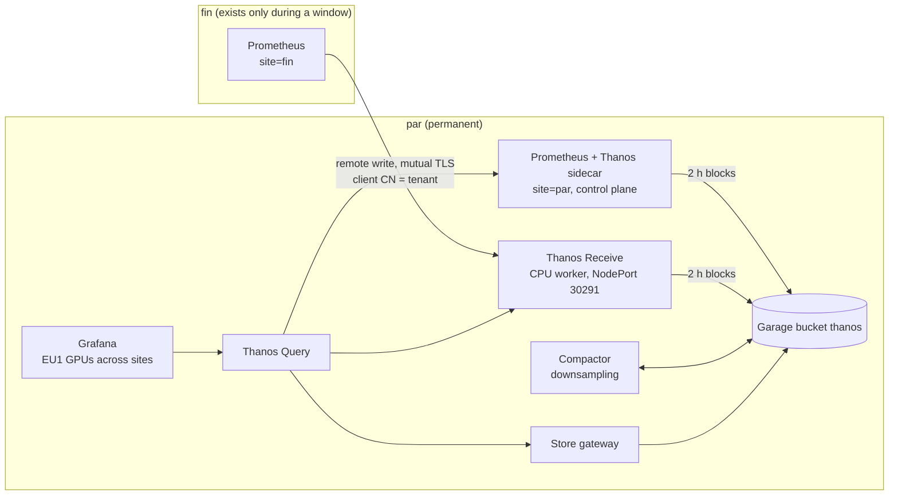

# One view of GPU metrics across two sites, with Thanos

!!! abstract "The use case"
    EU1 has a permanent site, par, and a site that only exists while a GPU window is
    paid for, fin. The partner wants one place to query every GPU of both sites, and
    fin's metrics have to stay queryable after fin is deleted. Here fin writes to Thanos Receive on par, par keeps its own Prometheus with a
    sidecar, and one Thanos Query reads both and the bucket. The design and its
    alternatives (Mimir, VictoriaMetrics) are in [ADR 0009](adr/0009-metrics-across-sites.md).

!!! warning "Planned: fin's GPUs, W2 (22 October)"
    par's side ran on 21 October: Receive, the sidecar, deduplication, uploads and
    downsampling. Rehearsal R on the same day ran fin's write path over the internet,
    from a fin control plane on a CPU instance. What needs fin's H200s (their DCGM
    series in par's Query, series per GPU) says "planned" until W2 has run.

## How it fits together



- **fin pushes, par never reaches in.** fin's firewall opens nothing to par, and
  par can't query a site that's been deleted. Port 30291 on par's CPU worker is open
  only to fin's node addresses. Tested from the laptop, it doesn't answer.
- **The certificate names the tenant.** Receive takes the tenant from the client
  certificate's common name, so fin can only write as `fin`. The CA is generated in
  the cluster by a Job and never goes into Git.
- **par doesn't depend on the CPU worker.** par's Prometheus stays on the control
  plane and uploads through a sidecar. It keeps working, alerting included, while the
  worker that runs Receive, Query and the compactor is powered off.

## What ran on par, 21 October

From the [hub capture](artifacts/platform/thanos-hub-20261021T114455Z.txt) and the
[bucket listing](artifacts/platform/thanos-bucket-20261021T114314Z.txt), both read
through par's API server:

| Check | Result |
|---|---|
| Stores Query sees | Receive (tenants `fin-sim`, `default-tenant`), par's sidecar, the store gateway |
| Deduplication, fin-sim's two replicas | 2 + 2 `up` series without, 2 with |
| Samples Receive accepted from fin-sim, 10 minutes | 65,040 |
| par's sidecar uploads | 14 blocks every 2 h since 20 October 06:00 UTC, 0 failures |
| Receive's last block before the worker's power-off | a 12 s `fin-sim` block, flushed and uploaded on shutdown |
| Port 30291 from the laptop | no answer within 5 s |

The 12 second block is the behaviour fin depends on. When Receive stops, it closes its
head and uploads what it holds (`cmd/thanos/receive.go` at v0.42.4), so the last
minutes of a window reach the bucket without waiting for a 2 hour block.

## Downsampling (simulated data)

A 2 hour window never makes a block long enough to downsample. Thanos only downsamples
blocks that span 40 hours. So `make thanos-backfill-sim` uploaded five days of a
synthetic series, labelled `site="sim-backfill"` and `simulated="true"`, at 10:35 UTC
([upload](artifacts/platform/backfill-upload-20261021T103510Z.txt)). By 11:43 UTC the
compactor had merged the 61 blocks into 8 hour and then 2 day blocks, and written two
**5 minute** blocks: 16 to 17 October and 18 to 19 October. The 1 hour level needs
10 days and doesn't appear.

## fin over the internet: rehearsal R, 21 October

The first attempt never got a machine: at 12:16 UTC Verda put the instance in status
"error" during `make fin-cp-up`, and no fin Prometheus ran. Yassine chose to retry once.
The retry ordered a fin control plane (CPU.8V.32G, FIN-01) at 15:33 UTC. It deleted it at
15:40 UTC, from the [step 2](artifacts/platform/thanos-fin-20261021T153930Z.txt) and
[step 4](artifacts/platform/thanos-after-20261021T155641Z.txt) captures:

| Check | Result |
|---|---|
| First `site="fin"` series in par's Query | 15:39:11 UTC, the same second kube-prometheus-stack was Healthy on fin |
| Tenant | `tenant_id="fin"`, from the client certificate cos's hook installed at 15:37 UTC |
| fin's remote write | 45,032 samples sent, 0 failed, 0 retried. The last sent timestamp equals the newest sample, so nothing was left behind |
| After `make fin-down` (15:40:26 UTC) | 16 minutes later, par's Query still serves fin's 11 `up` series, last sample 15:39:53 UTC |

That covers what only a real fin could test: port 30291 open to fin's actual address,
the certificate reaching fin, and remote write across the internet.

One thing the after-capture taught me: an instant query only sees a series for
5 minutes after its last sample. My first step 4 query asked "now", 16 minutes after
fin was gone, and found nothing, although Receive held all of it. Queries about a
deleted site have to look back, as `MODE=after` now does (`last_over_time(...[3h])`).
A dashboard panel showing fin after teardown needs a time range covering the window,
not "now".

## Series per GPU: the L4 on par, W1

From the [W1-b capture](artifacts/platform/thanos-par-20261021T170231Z.txt) and the
[follow-up](artifacts/platform/thanos-par-l4-growth-20261021T170350Z.txt), through
par's Query on 21 October:

| What | Measured |
|---|---|
| DCGM series for the L4, idle, from the recording rule | 40, from 16:58 to 17:02 UTC |
| The same, once the goodput job loaded the GPU | 41, from about 17:02:30 UTC |
| The series that appeared | `DCGM_EXP_CLOCK_EVENTS_TOTAL{clock_event="power_cap"}` |
| par's Prometheus head, for scale | 105,491 series |

Two things make the count move, both visible in the labels:

- **One series per clock-event reason.** `gpu_idle` was there from the start.
  `power_cap` appeared when the training job hit the L4's power limit.
- **Pod labels on a busy GPU.** dcgm-exporter adds `exported_pod`, `exported_namespace`
  and `exported_container` to series of a GPU a pod is using. Every new job puts its
  own pod name on new series, so the count churns with the workload, not only with
  the number of GPUs.

So the per-GPU figure for capacity planning is the maximum over a busy window, not an
idle reading. The recording rule is evaluated every minute and kept with the rest of
the data, so `max_over_time(gpu:dcgm_series:count[...])` over a window gives it.

While reading these labels I found the exporter names the node label `hostname`, not
`Hostname`. This repo's rules and dashboard grouped by the wrong one, and it's
corrected by PR #24, with a line for [findings](findings.md).

## fin's GPUs (planned, W2, 22 October)

Steps 6a to 6c: the H200s' DCGM series in par's Query, DCGM series per GPU from the
recording rules, and the cross-site panel before and after fin is torn down.

## What's simulated

Both are listed in [what is simulated](simulated.md) and labelled on every series:

- `site="fin-sim"`: a second Prometheus on par posing as fin, writing through the same
  mutual TLS path, so the pipeline runs before any H200 is rented.
- `site="sim-backfill"`: the synthetic blocks for the downsampling check.

## What two sites and three GPUs can't show

- A Receive hashring or replication. There is one Receive and one site writing to it,
  so the write path has a single point of failure. fin's Prometheus keeps its WAL and
  retries through a short outage.
- Cardinality at scale. Figures for 1,000 and 10,000 GPUs will be extrapolated from
  the measured series per GPU (planned, W2), not load-tested.
- Downsampling of real data, until par's own uploads span two days.

## Reproduce it

```bash
make thanos-check DRY_RUN=server     # free: flags, renders, dry run on par
make thanos-test-rules               # promtool tests of the GPU recording rules
make thanos-check-mtls               # local end to end of fin's write path
make thanos-capture MODE=hub         # par: stores, dedup, uploads, port closed
make thanos-backfill-sim             # SIMULATED: five days of blocks, then
make thanos-capture MODE=bucket      # about an hour later: the 5 minute blocks
make thanos-capture MODE=fin         # during a window (R, W2)
make thanos-capture MODE=after       # after fin-down
```

Free checks: [thanos-free-checks-20261020T084528Z.txt](artifacts/platform/thanos-free-checks-20261020T084528Z.txt),
[mtls-local-20261020T084352Z.txt](artifacts/platform/mtls-local-20261020T084352Z.txt).
