# One view of GPU metrics across two sites, with Thanos

!!! abstract "The use case"
    EU1 has a permanent site, par, and a site that only exists while a GPU window is
    paid for, fin. The partner wants one place to query every GPU of both sites, and
    fin's metrics have to stay queryable after fin is deleted. Here fin writes to Thanos Receive on par, par keeps its own Prometheus with a
    sidecar, and one Thanos Query reads both and the bucket. The design and its
    alternatives (Mimir, VictoriaMetrics) are in [ADR 0009](adr/0009-metrics-across-sites.md).

!!! warning "Planned: fin's real write path, rehearsal R (21 October) and W2 (22 October)"
    par's side ran on 21 October: Receive, the sidecar, deduplication, uploads and
    downsampling. fin's write path over the internet only exists while fin does. R
    didn't get that far (see below), so the results for fin say "planned" until W2,
    or a retried R, has run.

## How it fits together

```mermaid
flowchart LR
  subgraph fin["fin (exists only during a window)"]
    fprom["Prometheus<br/>site=fin"]
  end
  subgraph par["par (permanent)"]
    pprom["Prometheus + Thanos sidecar<br/>site=par, control plane"]
    recv["Thanos Receive<br/>CPU worker, NodePort 30291"]
    q["Thanos Query"]
    sg["Store gateway"]
    comp["Compactor<br/>downsampling"]
    bucket[("Garage bucket thanos")]
    graf["Grafana<br/>EU1 GPUs across sites"]
  end
  fprom -- "remote write, mutual TLS<br/>client CN = tenant" --> recv
  pprom -- "2 h blocks" --> bucket
  recv -- "2 h blocks" --> bucket
  comp <--> bucket
  sg --> bucket
  q --> pprom
  q --> recv
  q --> sg
  graf --> q
```



- **fin pushes, par never reaches in.** fin's firewall opens nothing to par, and
  par can't query a site that's been deleted. Port 30291 on par's CPU worker is open
  only to fin's node addresses. Tested from the laptop, it doesn't answer.
- **The certificate names the tenant.** Receive takes the tenant from the client
  certificate's common name, so fin can only write as `fin`. The CA is generated in
  the cluster by a Job and never goes into Git.
- **par doesn't depend on the CPU worker.** par's Prometheus stays on the control
  plane and uploads through a sidecar. It keeps working, alerting included, while the
  worker that runs Receive, Query and the compactor is powered off.

## What ran on par, 21 October

From the [hub capture](artifacts/platform/thanos-hub-20261021T114455Z.txt) and the
[bucket listing](artifacts/platform/thanos-bucket-20261021T114314Z.txt), both read
through par's API server:

| Check | Result |
|---|---|
| Stores Query sees | Receive (tenants `fin-sim`, `default-tenant`), par's sidecar, the store gateway |
| Deduplication, fin-sim's two replicas | 2 + 2 `up` series without, 2 with |
| Samples Receive accepted from fin-sim, 10 minutes | 65,040 |
| par's sidecar uploads | 14 blocks every 2 h since 20 October 06:00 UTC, 0 failures |
| Receive's last block before the worker's power-off | a 12 s `fin-sim` block, flushed and uploaded on shutdown |
| Port 30291 from the laptop | no answer within 5 s |

The 12 second block is the behaviour fin depends on. When Receive stops, it closes its
head and uploads what it holds (`cmd/thanos/receive.go` at v0.42.4), so the last
minutes of a window reach the bucket without waiting for a 2 hour block.

## Downsampling (simulated data)

A 2 hour window never makes a block long enough to downsample. Thanos only downsamples
blocks that span 40 hours. So `make thanos-backfill-sim` uploaded five days of a
synthetic series, labelled `site="sim-backfill"` and `simulated="true"`, at 10:35 UTC
([upload](artifacts/platform/backfill-upload-20261021T103510Z.txt)). By 11:43 UTC the
compactor had merged the 61 blocks into 8 hour and then 2 day blocks, and written two
**5 minute** blocks: 16 to 17 October and 18 to 19 October. The 1 hour level needs
10 days and doesn't appear.

## fin over the internet (planned)

- **Rehearsal R, 21 October: didn't reach the metrics path.** A fin control plane on
  CPU instances was to write to par. At 12:16 UTC Verda's instance went to status
  "error" during `make fin-cp-up`, so no fin Prometheus ever ran. A watch on par's
  Query saw no `site="fin"` series from 12:17 to 12:38 UTC, as expected with no fin.
  Whether R is retried before W2 is Yassine's call. Until it is, fin's write path over
  the internet has only been tested locally
  ([mTLS end to end](artifacts/platform/mtls-local-20261020T084352Z.txt)) and through
  fin-sim on par.
- **W2, 22 October.** Steps 6a to 6c: the H200s' DCGM series in par's Query, DCGM
  series per GPU from the recording rules, and the cross-site panel before and after
  fin is torn down.

## What's simulated

Both are listed in [what is simulated](simulated.md) and labelled on every series:

- `site="fin-sim"`: a second Prometheus on par posing as fin, writing through the same
  mutual TLS path, so the pipeline runs before any H200 is rented.
- `site="sim-backfill"`: the synthetic blocks for the downsampling check.

## What two sites and three GPUs can't show

- A Receive hashring or replication. There is one Receive and one site writing to it,
  so the write path has a single point of failure. fin's Prometheus keeps its WAL and
  retries through a short outage.
- Cardinality at scale. Figures for 1,000 and 10,000 GPUs will be extrapolated from
  the measured series per GPU (planned, W2), not load-tested.
- Downsampling of real data, until par's own uploads span two days.

## Reproduce it

```bash
make thanos-check DRY_RUN=server     # free: flags, renders, dry run on par
make thanos-test-rules               # promtool tests of the GPU recording rules
make thanos-check-mtls               # local end to end of fin's write path
make thanos-capture MODE=hub         # par: stores, dedup, uploads, port closed
make thanos-backfill-sim             # SIMULATED: five days of blocks, then
make thanos-capture MODE=bucket      # about an hour later: the 5 minute blocks
make thanos-capture MODE=fin         # during a window (R, W2)
make thanos-capture MODE=after       # after fin-down
```

Free checks: [thanos-free-checks-20261020T084528Z.txt](artifacts/platform/thanos-free-checks-20261020T084528Z.txt),
[mtls-local-20261020T084352Z.txt](artifacts/platform/mtls-local-20261020T084352Z.txt).
