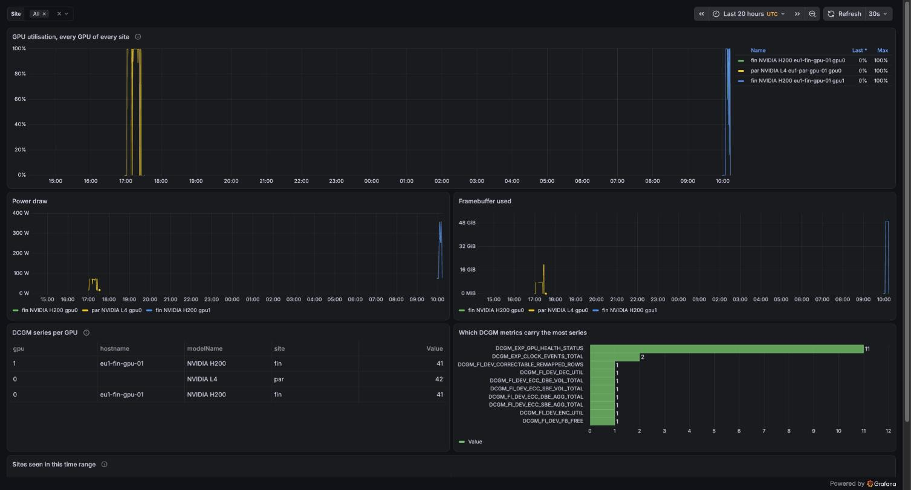
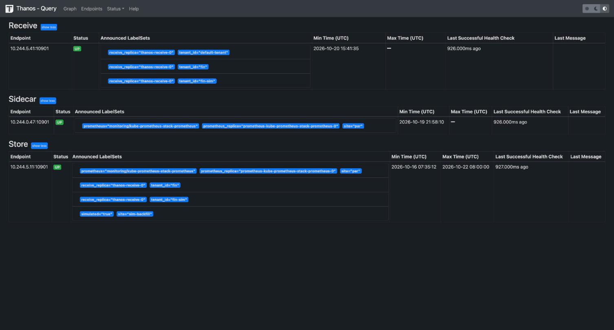
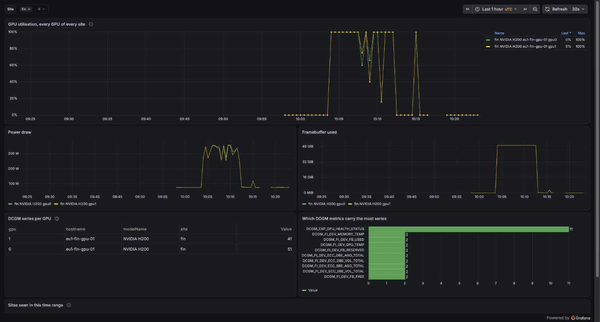
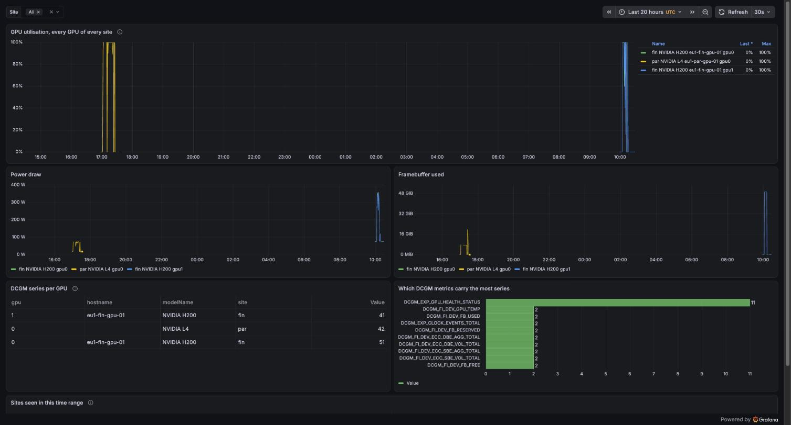

# One view of GPU metrics across two sites, with Thanos

!!! abstract "The use case"
    Nordhaven has a permanent site in Paris, and a site in Finland that only exists
    while its H200s are rented. Nordhaven wants one place to query every GPU of both
    sites, and the Finland metrics have to stay queryable after the Finland site is
    deleted. Here Finland writes to Thanos Receive in Paris, Paris keeps its own
    Prometheus with a sidecar, and one Thanos Query reads both and the bucket. The
    design and its alternatives (Mimir, VictoriaMetrics) are in
    [ADR 0009](adr/0009-metrics-across-sites.md).

!!! note "What ran"
    The Paris side ran on 21 October: Receive, the sidecar, deduplication, uploads,
    and downsampling on simulated blocks. A CPU-only test of the Finland site on the
    same day carried its metrics to Paris over the internet. On 22 October the Finland
    site ran with two H200s for about half an hour. Their DCGM series reached Paris,
    first on whole GPUs and then with one H200 split by MIG. They were still
    queryable in Paris after the Finland site was deleted.

## How it fits together


- **Finland pushes, Paris never reaches in.** The Finland firewall opens nothing to
  Paris, and Paris can't query a site that's been deleted. Port 30291 on the Paris CPU
  worker is open only to the Finland node addresses. Tested from my laptop, it
  doesn't answer.
- **The certificate names the tenant.** Receive takes the tenant from the client
  certificate's common name, so the Finland site can only write as `fin`. The CA is
  generated in the cluster by a Job and never goes into Git.
- **Paris doesn't depend on the CPU worker.** The Paris Prometheus stays on the
  control plane and uploads through a sidecar. It keeps working, alerting included,
  while the worker that runs Receive, Query and the compactor is powered off.

## The Paris hub, 21 October

From the [hub capture](artifacts/platform/thanos-hub-20261021T114455Z.txt), read
through the Paris API server:

| Check | Result |
|---|---|
| Stores Query sees | Receive (tenants `fin-sim`, `default-tenant`), the Paris sidecar, the store gateway |
| Deduplication, fin-sim's two replicas | 2 + 2 `up` series without, 2 with |
| Samples Receive accepted from fin-sim, 10 minutes | 65,040 |
| Paris sidecar uploads | 14 blocks every 2 h since 20 October 06:00 UTC, 0 failures |
| Port 30291 from my laptop | no answer within 5 s |

`fin-sim` is a second Prometheus in Paris posing as the Finland site, so the whole
write path could run before any H200 was rented.

## Downsampling and the last block (simulated data)

A site that lives for an hour never makes a block long enough to downsample: Thanos
only downsamples blocks that span 40 hours. So `make thanos-backfill-sim` uploaded five
days of a synthetic series, labelled `site="sim-backfill"` and `simulated="true"`, at
10:35 UTC on 21 October ([upload](artifacts/platform/backfill-upload-20261021T103510Z.txt)).
By 11:43 UTC the compactor had compacted the 61 blocks into 8 hour and then 2 day blocks,
and written two **5 minute** blocks:

```{ .sh .terminal }
$ make thanos-capture MODE=bucket
# capture-thanos.sh bucket, 20261021T114314Z, laptop clock, UTC. git 9065ce8

## Blocks in the thanos bucket (thanos tools bucket inspect, from the compactor pod)
ULID	FROM	UNTIL	RANGE	UNTIL-DOWN	#SERIES	#SAMPLES	#CHUNKS	COMP-LEVEL	COMP-FAILED	LABELS	RESOLUTION	SOURCE
...
01M5F2C2MW509PK05XAJ5JFBX3	2026-10-16T07:35:12Z	2026-10-17T23:59:12Z	40h24m0.001s	199h35m59.999s	2	970	8	3	false	simulated=true,site=sim-backfill	5m0s	compactor
...
01M5F2C2P86R2ZTTJVPA4D9C0A	2026-10-18T00:00:12Z	2026-10-19T23:59:12Z	47h59m0.001s	192h0m59.999s	2	1,152	10	3	false	simulated=true,site=sim-backfill	5m0s	compactor
...
01M5CZM2SP1JYPTFNEF1WQSNEB	2026-10-20T15:41:35Z	2026-10-20T15:41:47Z	12.06s	39h59m47.94s	2,329	2,329	2,329	1	false	receive_replica=thanos-receive-0,tenant_id=fin-sim	0s	receive
...
```

[Full listing](artifacts/platform/thanos-bucket-20261021T114314Z.txt)

The 1 hour level needs 10 days and doesn't appear. The last line is real data, not
simulated: a 12 second `fin-sim` block that Receive flushed and uploaded when the CPU
worker was powered off. That is the behaviour the Finland site depends on. When
Receive stops, it closes its head and uploads what it holds (`cmd/thanos/receive.go` at
v0.42.4), so the last minutes of a site reach the bucket without waiting for a 2 hour
block.

## Finland over the internet, without a GPU (21 October)

Before renting H200s, I tested the Finland write path with a Finland control plane on
a CPU instance (CPU.8V.32G, FIN-01). The first attempt never got a machine: at 12:16
UTC the provider put the instance in status "error". The retry ran from 15:33 to
15:40 UTC ([while it ran](artifacts/platform/thanos-fin-20261021T153930Z.txt),
[after deletion](artifacts/platform/thanos-after-20261021T155641Z.txt)):

| Check | Result |
|---|---|
| First `site="fin"` series in the Paris Query | 15:39:11 UTC, the same second kube-prometheus-stack was Healthy in Finland |
| Tenant | `tenant_id="fin"`, from the client certificate installed at 15:37 UTC |
| Finland remote write | 45,032 samples sent, 0 failed, 0 retried |
| After `make fin-down` (15:40:26 UTC) | 16 minutes later, the Paris Query still serves the 11 Finland `up` series, last sample 15:39:53 UTC |

That covered what only a real Finland site could test: port 30291 open to its actual
address, the certificate reaching it, and remote write across the internet.

It also taught me something about querying a deleted site. An instant query only sees
a series for 5 minutes after its last sample. My first query asked for "now", 16
minutes after the site was gone, and found nothing, although Receive held all of it.
Queries about a deleted site have to look back, as `MODE=after` now does
(`last_over_time(...[3h])`), and a dashboard showing it needs a time range that covers
the run.

## Finland's H200s in the Paris Query (22 October)

The Finland control plane came up at 09:50 UTC. Its Prometheus was Ready at 09:51:26,
and the Paris Query had its first `site="fin"` series at 09:51:30. About forty
seconds later, the remote write had sent 43,637 samples, none failed:

```{ .sh .terminal }
$ make thanos-capture MODE=fin
# capture-thanos.sh fin, 20261022T095211Z, laptop clock, UTC. git 17ecc08
...
## Sites and tenants seen (now)
# count by (site, tenant_id) (up)   (dedup=true)
{site="fin", tenant_id="fin"} 11
{site="fin-sim", tenant_id="fin-sim"} 2
{site="par"} 27
...
## fin's remote write: samples sent, failed, retried (now)
...
{__name__="prometheus_remote_storage_samples_failed_total"} 0
{__name__="prometheus_remote_storage_samples_retried_total"} 0
{__name__="prometheus_remote_storage_samples_total"} 43637
...
```

[Full capture](artifacts/platform/thanos-fin-20261022T095211Z.txt), and the two runs
before it: [Prometheus not up yet](artifacts/platform/thanos-fin-20261022T095107Z.txt),
[first series, counters still at 0](artifacts/platform/thanos-fin-20261022T095130Z.txt).

The H200 node had 2 GPUs allocatable at 09:55:44 UTC. Its DCGM series reached Paris at
09:58:10, after dcgm-exporter had crash-looped for about three minutes waiting for the
DCGM host engine. That is the price of a standalone host engine, already seen on the L4
([findings](findings.md)). At 09:58:40, with both H200s whole
([capture](artifacts/platform/thanos-fin-20261022T095840Z.txt)):

| What | Measured |
|---|---|
| GPUs in the Paris Query | 2x NVIDIA H200 on `eu1-fin-gpu-01`, `gpu` 0 and 1 |
| DCGM series per H200, from the recording rule | 40 each, the same as the L4 idle |
| The Finland Prometheus head, for scale | 52,662 series |
| Finland remote write | 733,067 samples sent, 0 failed, 0 retried |



*The cross-site dashboard at 10:13 UTC, over 20 hours: the Paris L4's training run on
the left, the two Finland H200s on the right. The L4's row in the table has no
hostname: while it ran, my rule grouped by `Hostname`, a label dcgm-exporter doesn't
set (it's `hostname`). I corrected it after that run. Over these 20 hours the L4
peaked at 42 series, one more than my capture during its run measured.*



*Thanos Query's Stores page at 10:13 UTC: Receive holds the `fin` tenant next to
`fin-sim`, and the store gateway announces a `fin` label set from blocks already in
the bucket.*

## After one H200 was split by MIG

At 10:17:24 UTC, MIG split GPU0 into two `3g.71gb` instances, each running another
tenant's pod, and left GPU1 whole ([use case 4](20-tenancy.md)). Five minutes later:

```{ .sh .terminal }
$ make thanos-capture MODE=fin
# capture-thanos.sh fin, 20261022T102230Z, laptop clock, UTC. git 17ecc08
...
## GPUs per site and model (now)
# count by (site, modelName) (DCGM_FI_DEV_GPU_UTIL)   (dedup=true)
{modelName="NVIDIA H200", site="fin"} 1
...
## DCGM series per GPU (recording rule)
# max by (site, modelName, hostname, gpu) (max_over_time(gpu:dcgm_series:count[3h]))   (dedup=true)
{gpu="0", hostname="eu1-fin-gpu-01", modelName="NVIDIA H200", site="fin"} 51
{gpu="1", hostname="eu1-fin-gpu-01", modelName="NVIDIA H200", site="fin"} 41
...
## Head series in each site's Prometheus (now, not only DCGM)
# max by (site) (prometheus_tsdb_head_series{job="kube-prometheus-stack-prometheus", site=~"par|fin"})   (dedup=true)
{site="fin"} 66491
{site="par"} 101058
...
```

[Full capture](artifacts/platform/thanos-fin-20261022T102230Z.txt)

Reading the labels on the Finland Prometheus itself
([labels](artifacts/platform/thanos-fin-mig-labels-20261022T102301Z.txt)) explains the
51:

- **Each MIG instance gets its own 20 series**, labelled `GPU_I_ID` and
  `GPU_I_PROFILE="MIG 3g.71gb"`, and dcgm-exporter attributes each one to the tenant
  pod using it (`team-a/mig-a` on instance 2, `team-b/mig-b` on instance 1).
- **The split GPU keeps 11 series for the device itself**, mostly
  `DCGM_EXP_GPU_HEALTH_STATUS`. So 11 + 20 + 20 = 51.
- **GPU1, whole, has 40**, and 41 over the run: one more series appeared while it was
  busy, as on the L4.

Two things on the dashboard are wrong after a MIG split, and neither is fixed yet:

- **`DCGM_FI_DEV_GPU_UTIL` isn't reported for MIG instances.** Every query that counts
  GPUs with it, including the "GPUs per site" figure above, sees 1 H200 where there
  are 2.
- **The recording rule groups by the GPU's UUID**, which both MIG instances share with
  their parent GPU. It shows GPU0 as one 51, not two instances of 20.

The fix is the next change to the rules and the dashboard: group by `GPU_I_ID` as
well, and count GPUs from a field every GPU and MIG instance reports.



*The dashboard filtered on Finland at 10:23 UTC, six minutes after the MIG split. The
table shows GPU0's 51 series as one row.*

## After the Finland site was deleted

The Finland site was deleted at 10:27:57 UTC. Seventeen seconds later, the Paris Query
still served it:

```{ .sh .terminal }
$ make thanos-capture MODE=after
# capture-thanos.sh after, 20261022T102814Z, laptop clock, UTC. git 17ecc08
...
## Sites and tenants seen (last value within 3 h)
# count by (site, tenant_id) (last_over_time(up[3h]))   (dedup=true)
{site="fin", tenant_id="fin"} 19
{site="fin-sim", tenant_id="fin-sim"} 2
{site="par"} 28

## Last sample per site (Unix seconds)
# max by (site) (max_over_time(timestamp(up)[3h:15s]))   (dedup=true)
{site="fin"} 1792664851.659
...
## GPUs per site and model (last value within 3 h)
# count by (site, modelName) (last_over_time(DCGM_FI_DEV_GPU_UTIL[3h]))   (dedup=true)
{modelName="NVIDIA H200", site="fin"} 13
...
## fin's remote write: samples sent, failed, retried (last value within 3 h)
...
{__name__="prometheus_remote_storage_samples_failed_total"} 0
{__name__="prometheus_remote_storage_samples_retried_total"} 0
{__name__="prometheus_remote_storage_samples_total"} 4676183
```

[Full capture](artifacts/platform/thanos-after-20261022T102814Z.txt)

The last Finland sample is from 10:27:31 UTC, 26 seconds before the deletion. Over the
whole run the Finland site sent 4,676,183 samples, and none failed or were retried.

The 13 is wrong, and it's the same kind of mistake as the 1 above. Counting
`last_over_time(...[3h])` counts every series that existed in those 3 hours, and a GPU
gets new series each time the exporter pod or the tenant pod on it changes. There were
2 GPUs. The same fix covers it: count GPUs by `gpu` and `hostname`, not by series.



*The same 20-hour view at 10:28 UTC, after the Finland site was deleted: the H200s'
series are still there, now read from Receive in Paris.*

## Series per GPU, and what they mean for capacity

From the L4 run in Paris on 21 October
([capture](artifacts/platform/thanos-par-20261021T170231Z.txt),
[follow-up](artifacts/platform/thanos-par-l4-growth-20261021T170350Z.txt)) and the H200
run in Finland:

| GPU | DCGM series |
|---|---|
| L4, idle | 40 |
| L4, under the training job | 41 (`DCGM_EXP_CLOCK_EVENTS_TOTAL{clock_event="power_cap"}` appeared) |
| H200, whole | 40, then 41 under load |
| H200 split into two MIG instances | 51 (11 for the device, 20 per instance) |

Two things make the count move, both visible in the labels:

- **One series per clock-event reason.** `gpu_idle` was there from the start.
  `power_cap` appeared when the training job hit the L4's power limit.
- **Pod labels on a busy GPU.** dcgm-exporter adds `exported_pod`,
  `exported_namespace` and `exported_container` to the series of a GPU a pod is using.
  Every new job puts its own pod name on new series, so the count churns with the
  workload, not only with the number of GPUs.

So the per-GPU figure for capacity planning is the maximum over a busy period, not an
idle reading. The recording rule is evaluated every minute and kept with the rest of
the data, so `max_over_time(gpu:dcgm_series:count[...])` gives it.

At 40 to 51 series per GPU, 1,000 GPUs make 40,000 to 51,000 DCGM series and 10,000
GPUs make 400,000 to 510,000, before pod-label churn. That is arithmetic from three
GPUs, not a load test. For scale, the DCGM series were 91 of the 66,491 series in the
Finland Prometheus: almost all of the rest came from the control plane's API server and
kubelets.

## What's simulated

Both are listed in [what is simulated](simulated.md) and labelled on every series:

- `site="fin-sim"`: a second Prometheus in Paris posing as the Finland site, writing
  through the same mutual TLS path.
- `site="sim-backfill"`: the synthetic blocks for the downsampling check.

The H200 series, the L4 series and the Finland write path are real.

## What two sites and three GPUs can't show

- **A Receive hashring or replication.** There is one Receive and one site writing to
  it, so the write path has a single point of failure. The Finland Prometheus keeps
  its WAL and retries through a short outage.
- **Cardinality at scale.** The figures above for 1,000 and 10,000 GPUs are
  extrapolated, not load-tested.
- **Downsampling of real data**, until the Paris uploads span two days.
- **The Finland site's last block in the bucket.** The Finland data sits in Receive's
  head. It reaches the bucket when Receive cuts a block or stops, as the 12 second
  `fin-sim` block above shows. I haven't listed the bucket since the H200 run.

## Reproduce it

```bash
make thanos-check DRY_RUN=server     # without a GPU: flags, renders, dry run in Paris
make thanos-test-rules               # promtool tests of the GPU recording rules
make thanos-check-mtls               # local end to end of the Finland write path
make thanos-capture MODE=hub         # Paris: stores, dedup, uploads, port closed
make thanos-backfill-sim             # SIMULATED: five days of blocks, then
make thanos-capture MODE=bucket      # about an hour later: the 5 minute blocks
make thanos-capture MODE=fin         # while the Finland site runs
make thanos-capture MODE=after       # after make fin-down
```

Checks without a GPU: [thanos-free-checks-20261020T084528Z.txt](artifacts/platform/thanos-free-checks-20261020T084528Z.txt),
[mtls-local-20261020T084352Z.txt](artifacts/platform/mtls-local-20261020T084352Z.txt).
