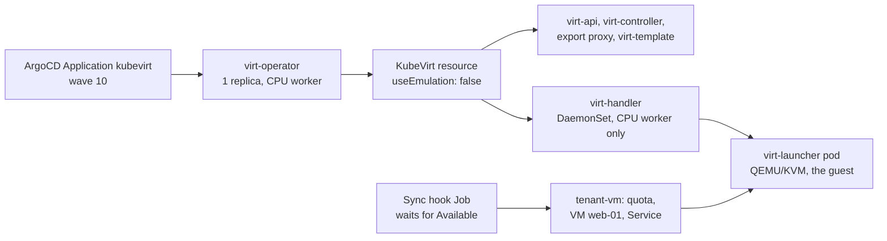

# VM tenants next to the GPU pods, with KubeVirt

!!! abstract "The use case"
    Some of EU1's tenants can't move to containers yet. They ship a whole operating
    system image, or a licensed appliance, or software that expects to own a kernel.
    EU1 wants to sell them capacity from the same fleet, run by the same people and
    tools. Here a VM runs on par's CPU worker as a Kubernetes object, under a tenant
    quota, next to the GPU workloads, and the guest itself says it runs on KVM.
    The choice of KubeVirt over a separate IaaS is in [ADR 0010](adr/0010-vm-tenants.md).

## What runs where



Everything sits on `eu1-par-cpu-01`, a Scaleway POP2-8C-32G that exposes `/dev/kvm`
with AMD SVM ([node facts](artifacts/par/cpu-worker-facts.txt)). Nothing runs on the
4 vCPU control plane.

## What I had to change from the release manifest

Each of these comes from reading KubeVirt's source at v1.9.1:

- **virt-operator insists on a control-plane node.** Its release Deployment requires
  one, with no override (`components/deployments.go`). A kustomize patch moves it to
  the CPU worker as one replica. The KubeVirt resource's `nodePlacement` places the
  rest.
- **ArgoCD can't tell when KubeVirt is ready.** ArgoCD v3.5.3 has health checks for
  VirtualMachine but not for the KubeVirt resource, so it would apply the tenant's VM
  before the operator had created the VM's CRD. A Sync hook Job waits for `Available`
  first.
- **A digest on the operator doesn't pin what it deploys.** The operator builds each
  component's image from its version as a tag, unless that component's `*_IMAGE`
  variable is set. So thirteen are set by digest
  ([`pin-images.yaml`](https://github.com/yassineteimi/ncp-partner-onboarding/blob/main/gitops/manifests/platform/kubevirt/pin-images.yaml)).
  The first deployment showed two I had missed: the virt-template components. They
  deploy by default, because their gate is Beta and KubeVirt turns Beta gates on, and
  they follow their own release, v0.2.3. They were running from tags until the fix
  ([before](artifacts/platform/kubevirt-20261021T103649Z.txt),
  [after](artifacts/platform/kubevirt-20261021T114554Z.txt)).

## First boot, 21 October

From [the capture](artifacts/platform/kubevirt-20261021T103649Z.txt), read through
par's API server:

| What | Measured |
|---|---|
| VM created to Running, from KubeVirt's own phase timestamps | 25 s (scheduled at +23 s) |
| Hypervisor, as the guest sees it (`systemd-detect-virt`, through the Service) | `kvm` |
| Guest boot, as the guest measured it (`systemd-analyze`) | 20.2 s (6.3 s kernel, 13.9 s userspace) |
| Guest CPU | AMD EPYC-Milan, 1 vCPU |
| Guest memory visible inside | 1903 MiB of the 2 GiB given |

The VM has kept running through two disturbances since. On 21 October the virt-template
pins rolled virt-operator and two Deployments. Then, about 12:05 to 12:10 UTC, the
control plane's disk saturated and its API server refused connections for about two
minutes. virt-operator, virt-controller and virt-template-controller crash-looped
until the API server came back. The VM instance created at 10:31 UTC never stopped:
the guest runs in its virt-launcher pod and doesn't need the control plane to keep
running.

## What a VM costs its tenant

The quota counts what the cluster really reserves for the VM, which is more than the
guest gets:

| Container in the virt-launcher pod | CPU request | Memory request |
|---|---|---|
| `compute` (QEMU, libvirt and the guest) | 1 | 2316 Mi, for a 2 GiB guest |
| `guest-console-log` (sidecar init container) | 5m | 35 M |
| Counted by the `tenant-vm` quota | 1005m | 2349 Mi |

So a 2 GiB VM costs its tenant about 2.3 GiB: about 15% more than the guest's memory.
A tenant sizing a quota from the guest's size alone would hit it early.

## Next to the GPU workloads, W1

`make kubevirt-capture` lists every pod holding a GPU at the moment it runs. During
W1, at 17:01:51 UTC on 21 October and before ws-readiness injected its SIMULATED
XID 79, [the capture](artifacts/platform/kubevirt-20261021T170151Z.txt) shows both
kinds of tenant on one cluster:

| Tenant | Pod | Node | What it holds |
|---|---|---|---|
| `tenant-vm` | `virt-launcher-web-01`, the VM `web-01` | `eu1-par-cpu-01` | 1 vCPU, 2 GiB, KVM, the same instance since 10:31 UTC |
| `tenant-a` | `goodput-xq462`, a training job | `eu1-par-gpu-01` | the L4, `nvidia.com/gpu: 1` |

One scheduler, one quota system and one GitOps flow placed both. The L4's reboot that
followed, part of use case 3, didn't touch the VM, which runs on another node.

## What one CPU worker can't show

- **Live migration.** With one worker there's nowhere to move a VM, so `web-01` sets
  `evictionStrategy: None` and stops when the worker is drained.
- **GPU passthrough to a VM.** It needs bare metal with IOMMU on. Both GPU types
  rented here are cloud VMs.
- **Disk import and snapshots.** They need CDI, which isn't installed. The VM boots
  from a container disk pinned by digest, and keeps nothing across restarts.

## Reproduce it

```bash
make kubevirt-check DRY_RUN=server   # free: digest, fields against KubeVirt's OpenAPI, dry run on par
make kubevirt-check BREAK=1          # must fail: a tag and two misspelt fields
make kubevirt-capture                # evidence through par's API server, changes nothing
```

Free checks: [kubevirt-free-checks-20261021T103727Z.txt](artifacts/platform/kubevirt-free-checks-20261021T103727Z.txt).
Nothing in this use case is simulated: the VM runs on KVM, not emulation.
