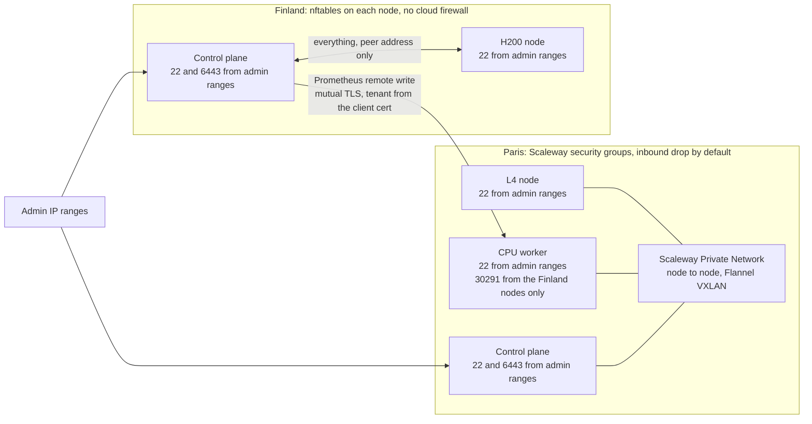
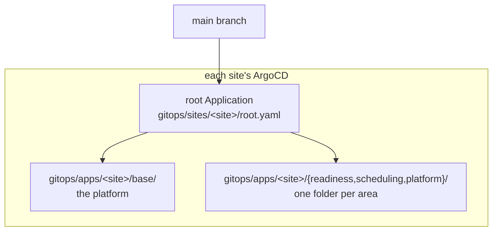
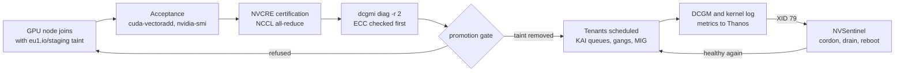

# Architecture

Two sites, two providers, one repository. Paris stays up between GPU runs: a small
control plane and a CPU worker that I power off when nothing needs it, plus an L4 node
created for a GPU run and destroyed after. The whole Finland site, control plane
included, exists only while I rent its H200 node. Everything that runs in either
cluster comes from ArgoCD reading `main`; a person runs `terraform` through `make`, and
`git push`.

## Sites and nodes

| Site | Node | Instance | Lifetime | What it runs |
|---|---|---|---|---|
| Paris (Scaleway fr-par-2) | `eu1-par-cp-01` | PLAY2-MICRO, 4 vCPU, 8 GB, €0.055/h | Persistent | Kubernetes control plane, ArgoCD, Prometheus and Grafana (kube-prometheus-stack), cert-manager |
| Paris | `eu1-par-cpu-01` | POP2-8C-32G, `/dev/kvm`, €0.29/h | Powered off between uses; its disk survives | Thanos Receive, Query, Store and Compact; Garage, the S3 bucket for Thanos blocks and training checkpoints; KAI Scheduler; Slurm through Slinky; KubeVirt and its VMs; the NVCRE controller and Kubeflow Trainer; NVSentinel's control components |
| Paris | `eu1-par-gpu-01` | L4-1-24G, €0.79/h | One GPU run | GPU Operator with the driver (595.91.07), device plugin, DCGM and its exporter; NVSentinel's node agents |
| Paris | KWOK nodes | none, simulated | Persistent | Fake GPU nodes that only KAI's scheduling tests use ([what is simulated](simulated.md)) |
| Finland (Verda FIN-02) | `eu1-fin-cp-01` | CPU instance (CPU.16V.64G on 22 October), about $0.19/h | One GPU run | Kubernetes control plane, ArgoCD, Prometheus with remote write to Paris, the NVCRE controller, Kubeflow Trainer, KAI Scheduler |
| Finland | `eu1-fin-gpu-01` | 2H200.141S.88V: 2× H200 SXM5 141 GB, NVLink, $11.66/h | One GPU run | GPU Operator with its driver component off, device plugin, DCGM and its exporter, MIG manager |

Every node carries `eu1.io/site` and `eu1.io/pool` (`control`, `cpu` or `gpu`).
Workloads that need the CPU worker select `eu1.io/pool: cpu`, so while it's off they
wait Pending instead of landing on Paris's 4 vCPU control plane.

Pinned versions on both sites: Kubernetes 1.36.5, containerd 2.3.6, Flannel v0.28.9,
ArgoCD chart 10.9.2, GPU Operator v26.7.2, NFD 0.19.0, kube-prometheus-stack 91.4.1.
The driver is the one exception, and it's deliberate: Paris runs 595.91.07, installed by
the GPU Operator as in Part 1, and Finland runs 580.178.04 from Verda's image
([ADR 0002](adr/0002-driver-ownership.md)).

## Network

Paris's nodes talk over a Scaleway Private Network, and only SSH and the API server face
the admin ranges. Verda has no private network or cloud firewall, so each Finland node
runs nftables: SSH and the API server from the admin ranges, everything from the other
node's address, nothing else. The one path between sites is Finland's Prometheus writing
to Thanos Receive on NodePort 30291 of Paris's CPU worker. The security group opens that
port to the Finland control plane when it's created, adds the H200 node's address when
that joins, and closes it when the site is deleted. Receive accepts only client certificates signed by its own CA, and takes the
tenant (`fin`) from the certificate's common name, so a Finland series can't claim to be
from Paris.

## GitOps

Each site's ArgoCD holds one root Application that reads `gitops/apps/<site>/`
recursively: an app-of-apps. Only Application manifests live there; the manifests and
Helm values they point at sit in `gitops/manifests/` and `gitops/values/`. Shared charts
read a base values file, then a per-site file, then one file per area if it exists, so
each area changes a shared chart by adding its own overlay instead of editing the base.

Sync waves order the platform on Paris: storage and the object-store credentials at -1,
NFD and kube-prometheus-stack at 0, the GPU Operator at 1, cert-manager at 3, tenant
namespaces at 4, Garage at 5, and everything else at 10 or later. Finland uses the same
waves for the subset it runs. ArgoCD needs the Application health check in `argocd-cm`
for waves to hold across an app-of-apps, as Part 1 found; both sites set it at bootstrap.

## How the use cases connect

A new node is useless to tenants until the gate removes its staging taint: only the
GPU Operator, NFD, the acceptance pods and NVCRE's jobs tolerate it. After promotion, KAI
places tenant pods from per-team queues, DCGM's series flow into Thanos, and NVSentinel
watches for faults. A node it drains comes back through the same health check before it
takes work again.

## What one site or one GPU can't show

- **NVLink across nodes, InfiniBand, NVSwitch fabrics.** The H200 node has two GPUs
  linked by NVLink inside one machine; nothing here spans machines at GPU speed.
- **Two real GPU sites at once.** The two GPU runs were a day apart, so the cross-site
  dashboard shows the L4 and the H200 from different times, never side by side live.
- **Scale.** One L4 and two H200s exercise every control path, not the load of a fleet.
