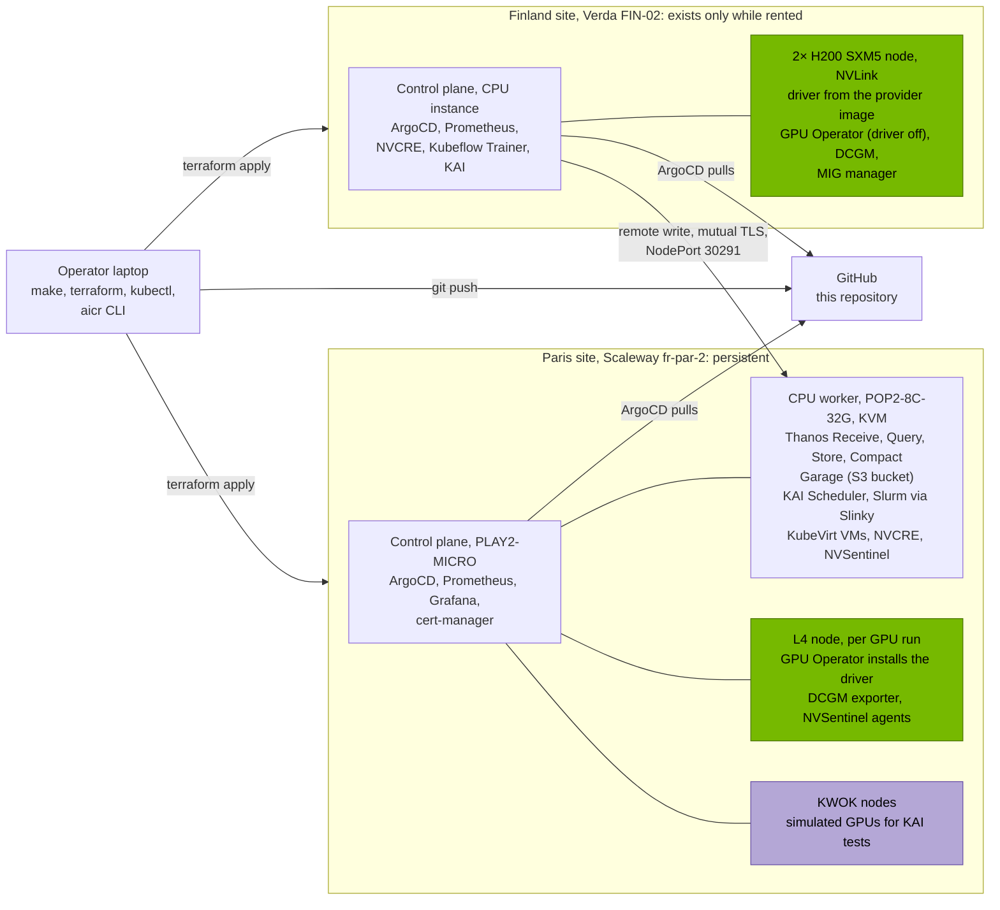

# Nordhaven: a GPU cloud partner from hardware handover to first workloads

Nordhaven is a fictional European NVIDIA Cloud Partner. It has just received two pools
of rented hardware: NVIDIA L4s in Paris (Scaleway) for inference and development, and a
2× H200 SXM5 node with NVLink in Finland (Verda) for training. Its first tenants are a
research group that lives in Slurm, a team running distributed PyTorch, and a customer
who still ships VMs. This project takes both pools from bare nodes to those tenants with
NVIDIA's open stack, from one Git repository, and records why each piece won over its
alternatives.

It's Part 2 of my GPU fleet work. [Part 1](https://github.com/yassineteimi/nvidia-gpu-fleet-poc)
built Day 2 operations by hand on one L4; here NVIDIA's tools take over, and where Part 1
did the same job, I compare the two on the same GPU model. The [AI Factory](ownership-map.md)
map shows where these layers sit in a partner's stack.

## Architecture



Both sites run upstream Kubernetes 1.36 through kubeadm, built by the same bootstrap
scripts and synced by ArgoCD from the same repository. The two differences come from
the providers: Scaleway's L4 boots with no driver, so the GPU Operator installs one, while
Verda's image already ships driver 580.178.04, so the operator runs with its driver
component off ([ADR 0002](adr/0002-driver-ownership.md)). The Finland site sends its
metrics to Paris as it runs, so they stay queryable after it's deleted. The
[architecture page](architecture.md) covers every component, the network and the sync
order.

## What ran

| Question a new partner must answer | NVIDIA piece | Where it ran | Result |
|---|---|---|---|
| **Day 1.** [Which versions go together on this hardware?](10-day1.md#aicr-a-known-good-software-stack) | AICR | Finland H200 | Part 1's hand-pinned versions compared with AICR's locked recipe; AICR refuses the provider's Ubuntu 26.04 |
| **Day 1.** [Is this node ready before tenants land on it?](10-day1.md#nvcre-certify-the-node-before-tenants-use-it) | NVCRE | Paris L4, Finland H200 | Certified at 351 GB/s all-reduce over NVLink, then let in; the gate now also refuses ECC off |
| **Day 2.** [When a GPU fails, how fast does it come back?](10-day2-nvsentinel.md) | NVSentinel | Paris L4 | XID 79 to training resumed in 288.8 s with no human, against 360.9 s with Part 1's controller |
| **Day 2.** [How do teams share GPUs that never cover demand?](20-tenancy.md) | KAI Scheduler, MIG | Paris (simulated GPUs), Finland H200 | Borrowing and exact reclaim, gangs that start whole or not at all, two tenants on MIG slices of one H200 |
| **Day 2.** [Can a Slurm group use the same platform?](21-hpc-slinky.md) | Slurm via Slinky | Paris CPU worker | `sbatch` jobs, a prolog that drains a sick node, a Kubernetes cordon that drains Slurm; GPUs designed, not run |
| **Day 2.** [Can operators see every GPU, even of a deleted site?](30-metrics-across-sites.md) | Thanos | Finland writes, Paris keeps | Finland's series in Paris 4 s after its Prometheus started, still there after the site was deleted |
| **Day 2.** [Can a VM tenant run next to the containers?](30-vm-tenants.md) | KubeVirt | Paris CPU worker | A VM booted on KVM in 20.2 s under a tenant quota while a GPU job used the L4 |
| **Day 2.** [Can the partner sell inference, not only GPU hours?](40-inference-dynamo.md) | Dynamo | Paris L4 (prepared) | Work in progress: designed and checked without a GPU, not run yet |

The GPU runs took place on 21 October (one L4, about 50 minutes) and 22 October (2× H200,
about 35 minutes). On the H200, the node went from order to both GPUs schedulable in
under 3 minutes, and Part 1's acceptance test passed before any other GPU workload ran on it:

```{ .sh .terminal }
$ make fin-acceptance
...
PASS  node advertises nvidia.com/gpu: 2
PASS  node carries pci-10de.present=true
INFO  DCGM exporter image on the node: nvcr.io/nvidia/k8s/dcgm-exporter:4.6.1-4.8.4-distroless
PASS  cuda-vectoradd printed Test PASSED
PASS  nvidia-smi sees the H200
PASS  driver in use is 580.178.04, the version reported by the provider image at boot
```

Full output: [acceptance-20261022T100225Z.txt](artifacts/fin/acceptance-20261022T100225Z.txt),
and the [bring-up timeline](artifacts/fin/gpu-bringup-20261022T095203Z.txt).

## Reading the rest

- [What is simulated](simulated.md): every injected fault, simulated GPU and emulated
  device, in one list. A GPU doesn't fail on request, so the faults were injected.
- [Decisions](adr/README.md): one record per real choice, each with at least two
  alternatives.
- [Findings](findings.md): what didn't behave as documented.

Names in commands, labels and outputs keep the project's short prefix and site codes:
`eu1-fin-gpu-01` is the Finland H200 node, `par` and `fin` are the Paris and Finland
sites, and `eu1.io/pool=gpu` is a node label. Renaming them would mean redeploying both
sites for no technical gain.
